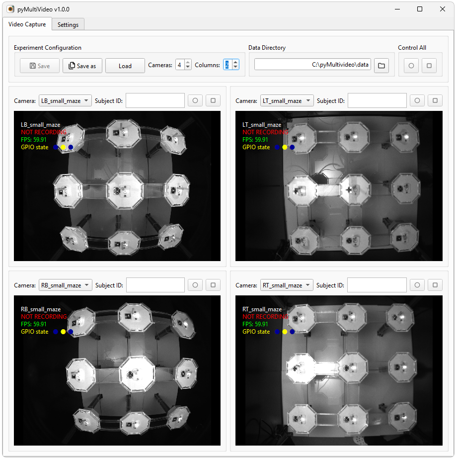

# pyMultiVideo

>**Open source, Python based, Multiple video acquisition.**

## Overview

pyMultiVideo is open source software for acquiring, visualising, compressing and synchronising video from multiple cameras.  It is designed for scientific applications, and implements functionality for recording the state of camera GPIO pins,  external triggering of frame acquisition, and saving detailed metadata with recorded videos.  It currently supports cameras from FLIR and Ximea, and USB webcams, and has primarily been tested with FLIR [Chameleon 3](https://www.teledynevisionsolutions.com/products/chameleon3-usb3/) and [Blackfly](https://www.teledynevisionsolutions.com/products/blackfly-s-usb3/#resources-support) cameras.  The application code is written entirely in Python and has a modular separation of camera API and GUI, designed to make it straightforward to add support for additional camera systems by implementing a new [camera API](./user-guide/camera-api.md) module.

pyMultiVideo code is hosted on [Github](https://github.com/pyMultiVideo), with a [discussion board](https://github.com/orgs/pyMultiVideo/discussions) for user support.

## Features

- Acquisition and visualisation of video and GPIO pin-state data from multiple cameras.

- Support for external frame triggering and outputting of frame trigger pulses from a connected microcontroller.

- h264 and h265 video compression on either the CPU or NVIDA GPU.

- Saving and loading of acquisition configurations for efficient high-throughput experiments.

- Open source Python application, implemented with PyQt, PyQtGraph, and ffmpeg.

## Getting started

See the [installation](./user-guide/installation.md) user guide for installation instructions.

Video viewing and recording is controlled from the Video Capture tab, application and camera settings are accessed in the Settings tab, see the [GUI](./user-guide/graphical-user-interface.md) user guide for more information.
