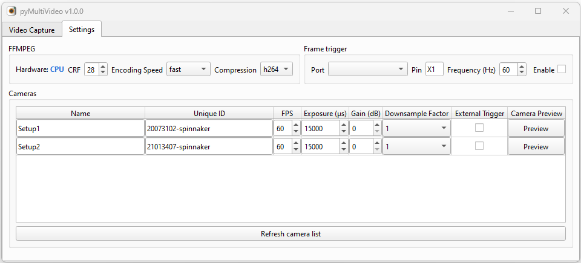

# Graphical User Interface

The GUI consists of a *Video Capture* tab for viewing and recording videos, and a *Settings* tab for controlling application and camera settings.

## Video Capture tab

The video capture tab displays video feeds from cameras, and has controls for selecting cameras, setting subject IDs and data directory, saving and loading acquisition configurations, and starting and stopping recordings.

### Experiment configurations

The `Save`, `Save as` and `Load` buttons can be used to save and load experiment configurations, i.e which cameras are in use, their corresponding subject IDs, and the data directory. Experiment configurations are saved as json files in the `/experiments` folder.

The `Cameras` control specifies the number of active cameras.

The `Columns` control specifies the number of columns in the camera feeds layout.

### Video feeds

Each active camera has its own video feed with associated controls:

- Which `Camera` to acquire video from.
- The `Subject ID` for this camera.
- The `Record` and `Stop` buttons are used to start and stop recording video to disk.  The record button is only enabled if a subject ID is specified for the camera.  If all cameras have a Subject ID specified then the record and stop buttons in the _Control All_ box are enabled, and can be used to start and stop recording for all cameras at once.

The default data directory for saving videos is the `/data` folder.  The data directory can be changed by clicking the "_File_" icon and selecting a new save directory.  Data filenames are determined by the subject ID and recording start date-time.

Video feeds have an information overlay indicating whether the feed is recording, the current frame rate (FPS), the current state of the camera GPIO pins, and whether frames are being dropped.

!!! warning "Dropped frames"
	The Dropped Frames warning shows when the GUI is unable to process frames fast enough to prevent frames being dropped.  This can happen for two reasons, indicated by different warning messages.  A *Camera buffer overflow* warning indicates that the GUI is not able to pull new images from the camera fast enough to prevent the image buffer in the camera from overflowing.  An *FFMPEG buffer overflow* warning indicates that FFMPEG is not able to encode new images for recording to disk as fast as they are being acquired.  In both cases reducing the number of cameras or camera frame rates will help avoid dropped frames.  Video encoding on the GPU can typically handle much higher total frame rates than encoding on the CPU.  When recording video, the metadata file records the number of dropped frames that occurred during recording. 

### Maximise and Full Screen modes

The keyboard shortcut `ctrl+M` maximises the video feeds within the window by hiding the controls.

The keyboard shortcut `ctrl+F` enables full screen display of the video feeds.

The `esc` key exits maximise or full screen modes.

## Settings Tab

The settings tab is used to configure application and camera settings.  When settings are changed they are saved to disk as json files in the `\config` directory.

### FFMPEG settings

The FFMPEG settings control video encoding parameters during recording to disk.

- The `hardware` label indicates whether encoding is done on CPU or GPU.  GPU encoding is only available if a NVIDIA graphics card that supports NVENC video encoding is installed on the computer.  GPU encoding is always used if available.
- The `CRF` control sets the FFMPEG *Constant Rate Factor* argument which determines the trade-off between file size and quality.   The valid range is 0-51, with lower values giving larger file sizes and higher quality.  FFMPEG defaults to 23 but pyMultivideo uses a default value of 28 which gives much smaller file sizes and acceptable quality.
- The `speed` control determines the trade-off between compute used for encoding and file size / quality.  pyMultivideo defaults to *fast*, changing the setting to *medium* or *slow* may improve video quality / file size but will lower the total framerate which FFMPEG is able to process without dropping frames. 
- The `compression` dropdown controls whether the h264 or h265 video encoding standard is used.  h265 is a newer standard and may give better file size / quality.  pyMultivideo defaults to h264 as is is very widely supported.

### Frame trigger settings

The frame trigger settings are used to configure pulse output from a microcontroller to trigger camera frame acquisition.  This is useful when frame acquisition times of multiple cameras need to be precisely synchronised, e.g. when multiple cameras are used for 3D tracking.  The frame trigger settings only control trigger pulse output, enabling/disabling external frame triggering for individual cameras is done using the camera settings table.  

The frame trigger output functionality works with microcontrollers running Micropython.  It has been tested with pyBoard v1.1 and Tiny2040 microcontrollers, but should work with any microcontroller that is running Micropython and appears to the computer as a USB serial device.

External frame triggering has only been tested on FLIR Chameleon and Blackfly cameras, on both cameras the optically isolated input pin is used for the frame trigger signal.

The following controls are used to configure trigger pulse output:

- The `Port` dropdown selects the serial COM port that the microcontroller is on.
- The `Pin` control specifies which microcontroller pin to output pulses on, e.g. `X1` or `11`.
- The `Frequency` control specifies the frequency of pulse output in Hz.
- The `Enable` checkbox enables / disables pulse output.

### Camera settings

The *Cameras* table is used to name and configure cameras:

- The camera `Name` determines how it appears in the camera select drop-down menus, if no name is specified the Unique ID is used to identify the camera.
- The camera `Unique ID` combines the camera system (e.g. Spinnaker) and the devices unique hardware ID number.
- The `FPS` control sets the camera frame rate in Hz.
- The `Exposure` control sets the camera exposure time in microseconds.
- The `Gain` control sets the gain applied to camera images, higher gain makes images brighter but more noisy.  
- The `Downsampling Factor` control determines whether spatial down-sampling is applied to the image before encoding it to disk.  The default value of 1 indicates no down-sampling, higher down-sampling factors give smaller video files but lower spatial resolution.
- The `External Trigger` control determines whether frame acquisition is triggered by external trigger pulses or the cameras internal timer.
- The `Preview` button displays the camera video feed below the camera controls table.  Note - spatial down sampling is applied by FFMPEG when video is saved to disk so is not visible in the camera preview.
