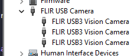

# Troubleshooting

If you are having trouble with starting or using the application, and the problem that you are having isn't addressed here, please post on the pyMultivideo [discussions](https://github.com/orgs/pyMultiVideo/discussions) board.

### conda not recognised

If when you run the file `LAUNCH_pyMV.bat` you get an error saying `conda is not recognized` this indicates that the conda python package management tool is either not installed or has not been added to the system PATH environment variables.  See the [installation](./installation.md#install-ffmpeg) instructions for how to install conda and add it to the system path.

### FFMPEG path not found

If you get an error message on starting the program saying FFPEG path not found, this indicates that FFMPEG is either not installed or has not been added to the system PATH environment variables.   See the [installation](./installation.md#install-ffmpeg) instructions for how to install FFMPEG and add it to the system path.

### Cameras not detected in GUI

If the GUI runs but your cameras are not detected this could be due to one of the following reasons:

- The camera system or specific camera model are not supported by pyMultivideo.  Currently pyMultivideo supports cameras from FLIR (only tested with Chameleon 3 and Blackfly cameras), Ximea (only tested with xiQ cameras) and USB webcams.
- The camera drivers are not correctly installed (e.g [Spinnaker](https://www.teledynevisionsolutions.com/products/spinnaker-sdk/) for FLIR cameras).
- The Python module for controlling the cameras is not correctly installed (e.g. PySpin for FLIR cameras).

See the [installation](./installation.md#install-required-camera-system-modules) instructions for installing FLIR or Ximea camera drivers and python modules.

Other steps that may be useful for debugging the problem are:

- Check whether the cameras are detected in the windows Device Manager, e.g. FLIR cameras should appear in the device manager as:

- Check whether the camaras show up in the viewer application provided by the camera manufacturer (e.g. the FLIR Spinview application or [Ximea CamTool](https://www.ximea.com/support/wiki/allprod/XIMEA_CamTool)).

If the cameras show up in the camera manufactures viewing application but not in pyMultivideo this likely indicates that the Python module for controlling the cameras in not installed correctly.

### Video not encoding on GPU

The *hardware* label in the settings tab FFMPEG controls box indicates whether video encoding is using the computers CPU or GPU.  Video encoding on the CPU uses a lot of CPU resources, so for encoding multiple video streams at high framerates GPU encoding is preferable.  

To compress videos on the GPU it is necessary to have an NVIDIA GPU that supports NVENC video encoding, for information about which GPUs support this see [here](https://developer.nvidia.com/video-encode-and-decode-gpu-support-matrix-new).   If you have a compatible GPU installed but encoding is still happening on the CPU this could be because:

- The GPU does not have the required driver installed.  Try installing the latest Studio Driver for your graphics card from the NVIDIA [driver downloads](https://www.nvidia.com/en-us/drivers/) page.
- The version of FFMPEG you have installed does not support GPU encoding.  Try reinstalling FFMPEG using the [installation](./installation.md#install-ffmpeg) instructions.

See also [this](https://docs.nvidia.com/video-technologies/video-codec-sdk/13.1/ffmpeg-with-nvidia-gpu/index.html) page from NVIDIA for more information.
